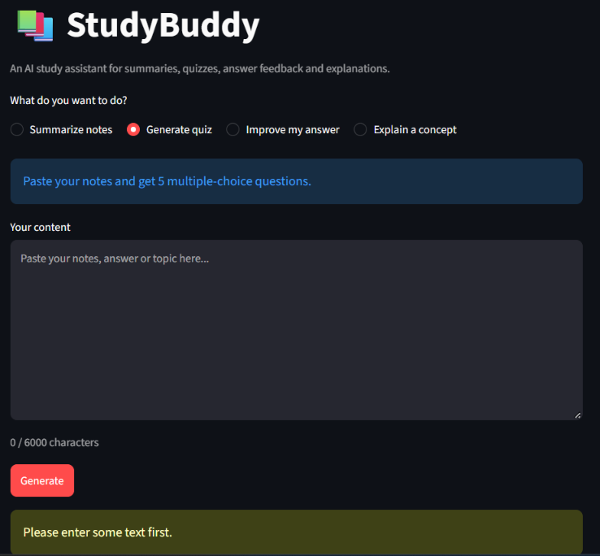

#Beginner
# StudyBuddy: AI Study Assistant (Beginner Level)

A Streamlit app that helps students study using an LLM (Google Gemini).

## Features
- **Summarize notes**: overview, key points and key terms
- **Generate quiz**: 5 multiple-choice questions with answers and explanations
- **Improve my answer**: feedback plus a rewritten, stronger answer
- **Explain a concept**: simple explanation, example and a common mistake

## How it works
1. The user picks a mode and pastes text.
2. The input is validated (`validators.py`).
3. A structured prompt is built from the mode's template (`prompts.py`).
4. The prompt is sent to the Gemini API (`llm_client.py`).
5. The output is shown as formatted markdown, with a plain-text copy option.

## Prompt structure
Every prompt has four parts: **role** (who the AI is), **task** (what to do), **format** (exact output layout) and **rules** (only use the given notes, don't invent facts). This keeps the output relevant and consistent, so the app is a study workflow, not a generic chatbot.

## Validation
- Empty input is rejected
- Fewer than 20 characters is rejected
- More than 6000 characters is rejected
- Input with no letters (only numbers or symbols) is rejected

## Error handling
- Missing or invalid API key: clear message
- Temporary failures (503, rate limits, timeouts): retried automatically up to 3 times with increasing delay
- Wrong model name (404), network problems and empty responses each have their own friendly message
- The app never shows a raw crash

## Setup
```
git clone <your-repo-url>
cd AI-ENGINEER-TASK
python -m venv venv
venv\Scripts\activate
pip install -r requirements.txt
```
Create a `.env` file (see `.env.example`):
```
API_KEY=your_key_here
MODEL_NAME=gemini-3.8-flash
```
Run:
```
streamlit run 01-Beginner/app.py
```

## Screenshots
   

## Limitations
- Output quality depends on the model and the input
- No saved history between sessions